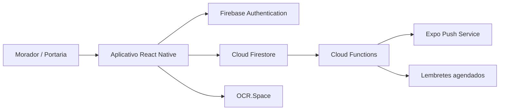
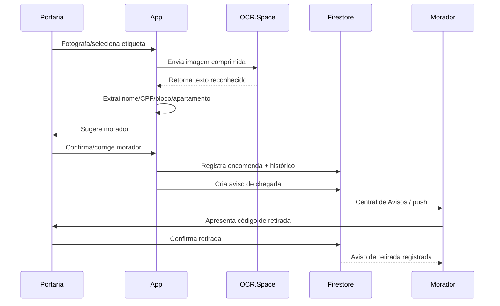

# Arquitetura do Cegonha

## Visão geral

O Cegonha é um aplicativo móvel para organização de encomendas em condomínios. A aplicação foi construída com **React Native + Expo + TypeScript** e utiliza **Firebase Authentication, Cloud Firestore e Cloud Functions**. O reconhecimento de etiquetas é feito pela API **OCR.Space**.

## Camadas

- **Interface:** telas em `Screens/` e componentes em `components/`.
- **Estado/contextos:** autenticação, tema, acessibilidade e feedback em `context/`.
- **Regras de negócio:** serviços em `services/`, como encomendas, vínculo, notificações, push e identificadores.
- **Validação/utilitários:** `utils/`.
- **Persistência e autorização:** Firestore + `firestore.rules`.
- **Backend privilegiado:** `functions/`, utilizado para push, lembrete automático e exclusão segura de conta.

## Perfis

O sistema possui dois perfis:

- **Morador:** acompanha encomendas, registra entregas previstas, recebe avisos, usa o Mural e gerencia seu perfil.
- **Portaria:** recebe encomendas, usa OCR, confirma retiradas, aprova vínculos, modera o Mural e consulta relatórios.

O Cegonha não possui chat privado. A comunicação é feita por avisos operacionais e pelo Mural coletivo do condomínio.

## Fluxo principal de encomenda

## Decisões de segurança

- autorização real fica nas **Firestore Rules**, não apenas nas telas;
- perfis são isolados por condomínio;
- e-mail precisa estar verificado para operações protegidas;
- CPF, telefone e e-mail têm registros de unicidade não legíveis publicamente;
- dados de autoria são confrontados com a identidade autenticada;
- registros de encomenda não podem ser apagados pelo cliente;
- exclusão de conta ocorre no backend e anonimiza históricos que precisam ser preservados;
- a última Portaria de um condomínio não pode excluir a própria conta sem uma substituta.

## Recursos nativos e Expo Go

O fluxo principal, incluindo OCR.Space, funciona no Expo Go. Google Sign-In nativo e push remoto dependem de Development Build/APK. O CI também produz uma APK Android de validação para testar o prebuild nativo.
