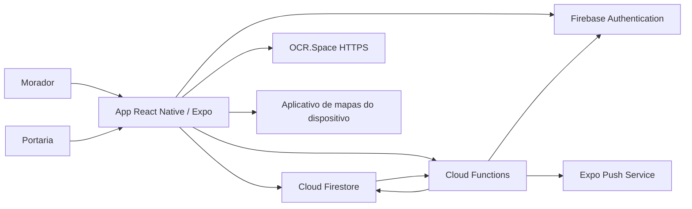
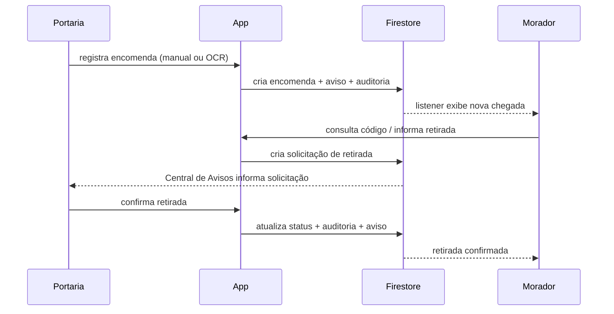

# Arquitetura do Cegonha

O Cegonha é um aplicativo móvel para gestão de encomendas em condomínios. A aplicação foi construída em React Native com Expo e TypeScript e usa Firebase para autenticação, persistência e automações de backend.

## Visão geral

## Camadas

### Interface móvel

As telas ficam em `Screens/` e são separadas por responsabilidade. A navegação distingue os perfis Morador e Portaria. Recursos comuns, como perfil, privacidade, acessibilidade, mural e notificações, são reutilizados pelos dois perfis quando aplicável.

### Contextos e componentes

Os contextos de autenticação, tema, acessibilidade e feedback concentram estado compartilhado. Componentes reutilizáveis evitam duplicação de elementos visuais e comportamentos. A identidade visual oficial é exposta pelo componente `BrandLogo`.

### Serviços

A pasta `services/` concentra operações de negócio, como encomendas, vínculo com condomínio, identificadores únicos, interações e push. As telas não devem concentrar regras sensíveis de autorização: a proteção definitiva fica no Firestore e, para operações administrativas, nas Cloud Functions.

### Firebase Authentication

O Authentication gerencia sessão e provedores de acesso. O fluxo principal exige e-mail verificado para acessar dados protegidos. Login por Google é um recurso nativo e requer development build/APK.

### Cloud Firestore

O Firestore armazena dados operacionais e oferece listeners em tempo real. As regras em `firestore.rules` aplicam isolamento por condomínio, separação de papéis e integridade de identidade mesmo quando um cliente modificado tenta ignorar a interface.

### Cloud Functions

As Functions são usadas quando a operação não deve depender da confiança no cliente ou precisa ocorrer sem um aparelho aberto:

- envio de push ao criar uma notificação;
- lembrete diário de encomendas há mais de três dias sem retirada;
- exclusão de conta com remoção de dados descartáveis e anonimização do histórico necessário.

A exclusão de uma conta de Portaria é bloqueada quando isso deixaria o condomínio sem outra Portaria vinculada.

### OCR

A imagem da etiqueta é reduzida/comprimida no aparelho e enviada temporariamente ao OCR.Space por HTTPS. O texto bruto e a fotografia não são persistidos no Firestore. O resultado é analisado pelo parser do Cegonha e cruzado com os moradores do condomínio. A Portaria sempre confirma a correspondência antes de registrar a encomenda.

## Fluxo principal

## Princípios adotados

1. **Menor privilégio:** cada perfil acessa somente o necessário para sua função.
2. **Autorização no servidor:** validação de tela melhora UX, mas as regras do Firestore são a barreira de segurança.
3. **Rastreabilidade:** ações críticas geram histórico ou auditoria.
4. **Confirmação humana do OCR:** reconhecimento de texto auxilia, mas não decide sozinho o destinatário.
5. **Minimização de dados:** diretórios públicos ao condomínio não carregam CPF, telefone ou e-mail.
6. **Falha segura:** push e telemetria não devem cancelar o registro principal de uma encomenda.
7. **Build reproduzível:** `package-lock.json`, CI e geração automatizada de APK reduzem diferenças entre ambientes.

## Componentes externos

| Componente | Finalidade | Observação |
|---|---|---|
| Firebase Authentication | autenticação e sessão | e-mail/senha e Google |
| Cloud Firestore | banco em tempo real | protegido por regras versionadas |
| Cloud Functions | tarefas privilegiadas/agendadas | necessário para exclusão, lembrete automático e push backend |
| OCR.Space | reconhecimento da etiqueta | imagem temporária enviada por HTTPS |
| Expo Push Service | entrega de push | complemento da Central de Avisos interna |
| EAS / Gradle | build Android | preview APK e produção |

## Limites de escopo

O sistema atual possui os perfis Morador e Portaria. Não há perfil de síndico nem chat privado. A comunicação prevista é operacional por notificações e coletiva pelo Mural. Esses limites são intencionais e fazem parte do escopo do TCC.
