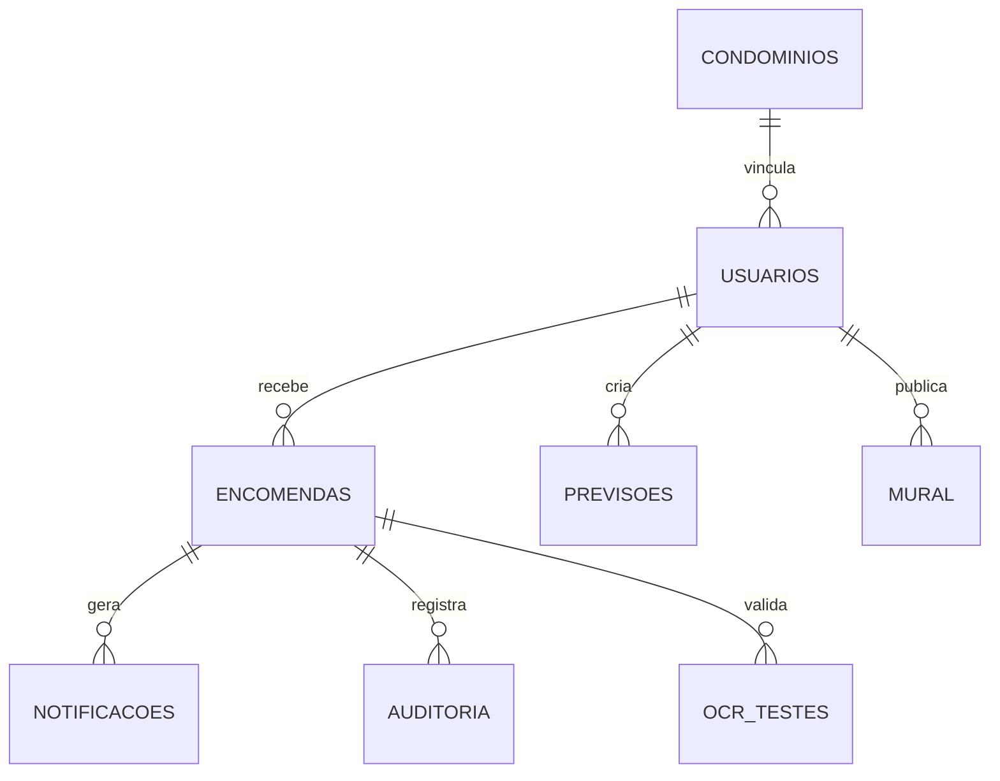

# Modelo de dados do Cegonha

O banco principal é o **Cloud Firestore**. O acesso é controlado por `firestore.rules`.

| Coleção | Finalidade | Dados principais |
|---|---|---|
| `usuarios` | Perfil privado | nome, e-mail, CPF, telefone, tipo e vínculo |
| `diretorioUsuarios` | Diretório mínimo do condomínio | nome, tipo, bloco e apartamento |
| `identificadoresUsuarios` | Reserva de unicidade | hash/chave de CPF, telefone e e-mail |
| `condominios` | Documento público mínimo por código | nome, código, criador |
| `condominioDetalhes` | Dados privados do condomínio | endereço |
| `solicitacoesCondominio` | Pedidos de vínculo | solicitante, condomínio, status e decisão |
| `encomendas` | Registro operacional central | destinatário, status, datas, códigos e histórico |
| `encomendas/{id}/interacoes` | Interações do morador | retirada solicitada, contestação |
| `notificacoes` | Central de Avisos | destinatário, tipo, mensagem, referência e leitura |
| `previsoes` | Entregas esperadas | morador, descrição, condomínio e data |
| `mural` | Comunicação coletiva | autor, texto, resposta e condomínio |
| `muralDenuncias` | Denúncias do Mural | publicação, denunciante, motivo e status |
| `muralBanidos` | Controle interno de bloqueios | usuário, condomínio e responsável pela moderação |
| `muralBanimentosPublicos` | Estado mínimo de banimento | usuário, condomínio e ativo |
| `auditoria` | Rastreabilidade operacional | ação, ator, alvo, encomenda e data |
| `ocrLeituras` | Métricas de leituras confirmadas | tempo, campos detectados, score e confirmação |
| `ocrTestes` | Avaliação acadêmica do OCR | acerto top-1, score, condições e campos reconhecidos |
| `pushDispositivos` | Tokens de push | usuário, token, tipo e condomínio |
| `fotosPerfil` | Foto opcional de perfil | imagem reduzida em base64 |

## Relações importantes

## Retenção e exclusão

Ao excluir uma conta, dados pessoais diretamente associados à conta são removidos sempre que possível. Registros de encomendas e auditorias necessários para manter a integridade do histórico são **anonimizados**, substituindo nome/identificador por “Conta removida”. Isso evita apagar eventos operacionais já ocorridos.

A foto da etiqueta e o texto bruto retornado pelo OCR **não são persistidos no Firestore**.
