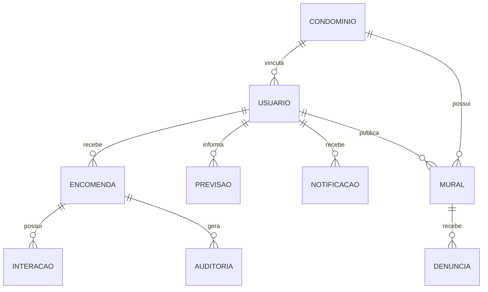

# Modelo de dados do Cegonha

O Cegonha usa Cloud Firestore. Os documentos carregam `condominioId` sempre que a informação pertence a um condomínio, permitindo que as regras filtrem acesso por vínculo.

## Coleções principais

| Coleção | Finalidade | Dados relevantes | Acesso esperado |
|---|---|---|---|
| `usuarios` | perfil privado | nome, e-mail, CPF, telefone, tipo, vínculo | próprio usuário e Portaria do mesmo condomínio quando necessário |
| `diretorioUsuarios` | diretório operacional mínimo | nome, tipo, bloco, apartamento, condomínio | usuários vinculados ao mesmo condomínio |
| `identificadoresUsuarios` | unicidade de CPF/telefone/e-mail | chave reservada e UID | sem leitura pública |
| `condominios` | identificação operacional | nome, código, criador | usuários autorizados conforme regras |
| `condominioDetalhes` | endereço/localização | endereço e dados privados | somente vinculados ao condomínio |
| `solicitacoesCondominio` | entrada de Morador/Portaria | solicitante, condomínio, status, decisão | solicitante e Portaria responsável |
| `encomendas` | registro principal | destinatário, datas, status, código, histórico, origem | Morador dono e Portaria do condomínio |
| `encomendas/{id}/interacoes` | ações iniciadas pelo Morador | retirada solicitada/contestação | Morador relacionado e Portaria |
| `notificacoes` | Central de Avisos | tipo, mensagem, destinatário, referência | destinatário ou Portaria do condomínio |
| `previsoes` | entregas esperadas | Morador, descrição, período | Morador e Portaria do condomínio |
| `ocrLeituras` | histórico operacional OCR | campos confirmados e métricas | Portaria do condomínio |
| `ocrTestes` | avaliação acadêmica do OCR | tempo, iluminação, acerto top-1 | Portaria do condomínio |
| `auditoria` | rastreabilidade | ator, ação, alvo, referência | Portaria e, quando aplicável, Morador alvo |
| `mural` | comunicação coletiva | autor, texto, resposta | usuários do mesmo condomínio |
| `muralDenuncias` | denúncias | publicação, denunciante, motivo, status | denunciante e Portaria |
| `muralBanidos` | moderação interna | usuário, estado, moderador | Portaria; consulta própria para bloqueio |
| `muralBanimentosPublicos` | estado mínimo de banimento | usuário, condomínio, ativo | usuários do condomínio |
| `fotosPerfil` | foto comprimida | imagem JPEG base64 | próprio usuário e usos autorizados |
| `pushDispositivos` | roteamento de push | UID, token Expo, tipo, condomínio | próprio dispositivo/rotinas autorizadas |

## Relações lógicas

## Separação entre perfil privado e diretório

`usuarios` contém dados pessoais necessários para cadastro e atendimento. `diretorioUsuarios` contém apenas o mínimo para que pessoas do condomínio sejam encontradas no fluxo operacional. CPF, telefone e e-mail não são copiados para o diretório.

## Integridade de encomendas

Na criação, as regras conferem se:

- a Portaria autenticada pertence ao mesmo condomínio;
- o `porteiroId` e o nome correspondem ao perfil real;
- o Morador existe e pertence ao condomínio;
- nome, bloco e apartamento enviados correspondem ao perfil real;
- campos críticos, como código de retirada e destinatário, não podem ser alterados arbitrariamente depois.

## Retenção e exclusão

Ao excluir uma conta, dados descartáveis ligados diretamente ao usuário são removidos. Registros históricos necessários para rastreabilidade não são apagados indiscriminadamente: identificadores e nomes são substituídos por um identificador anônimo derivado por hash e pelo rótulo `Conta excluída`.

A estratégia evita manter CPF, telefone, foto e vínculo ativo desnecessariamente, sem destruir o histórico de recebimento/retirada já concluído.

## Datas e timestamps

Dados críticos usam `serverTimestamp()` sempre que possível. O histórico também pode armazenar data ISO para exibição estável. A decisão de autorização nunca deve depender apenas do horário informado pelo cliente.
